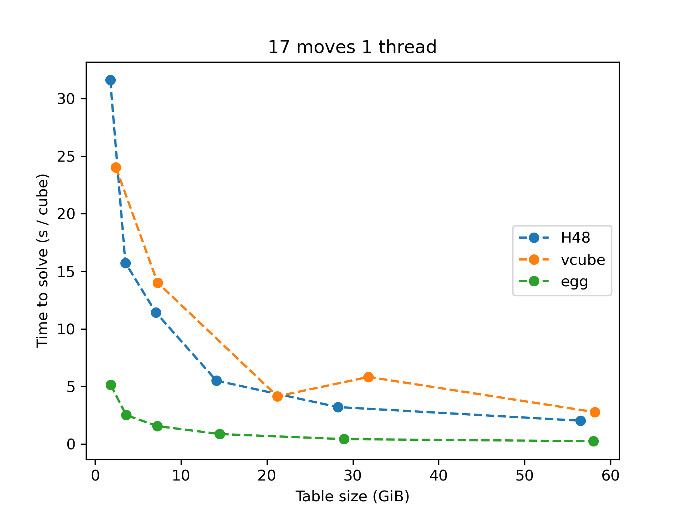
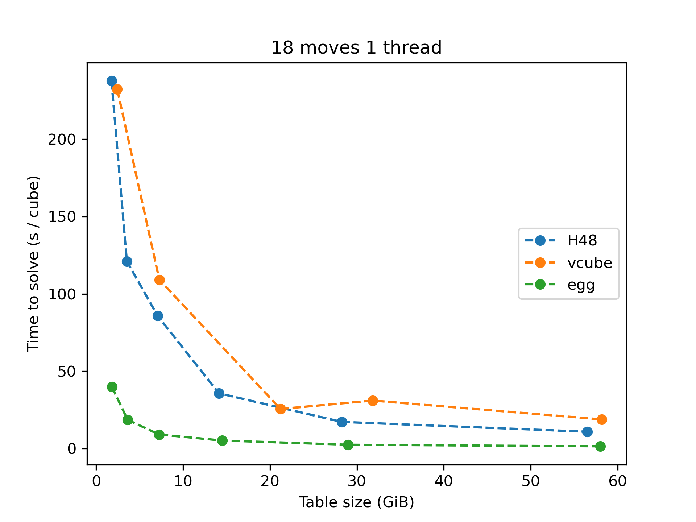
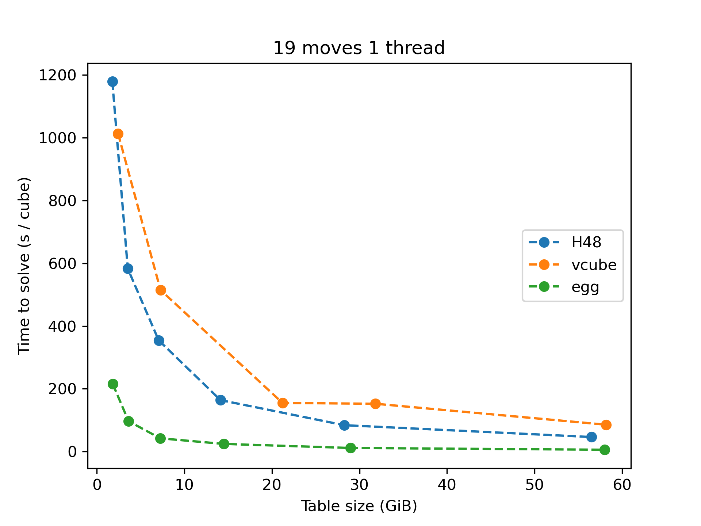
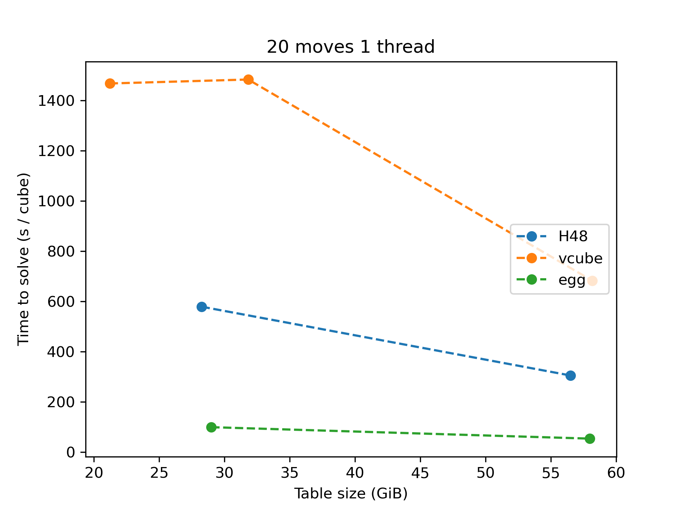
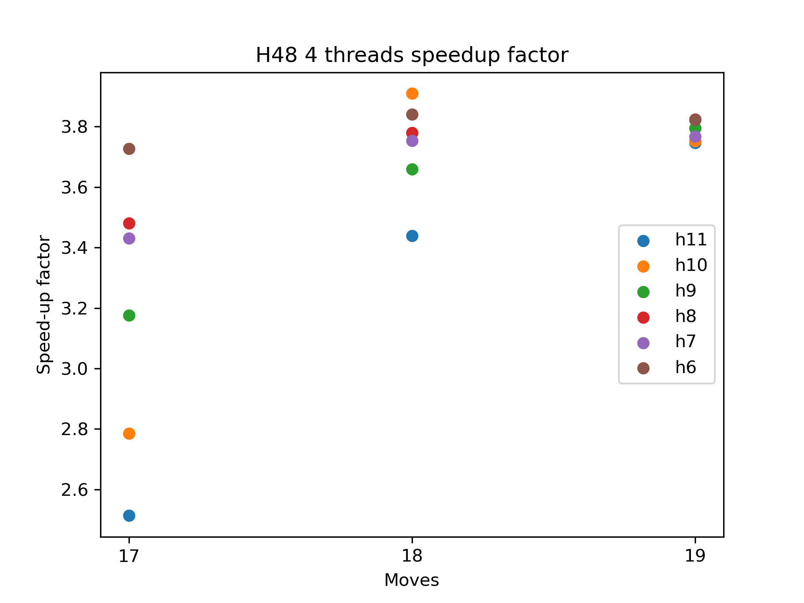
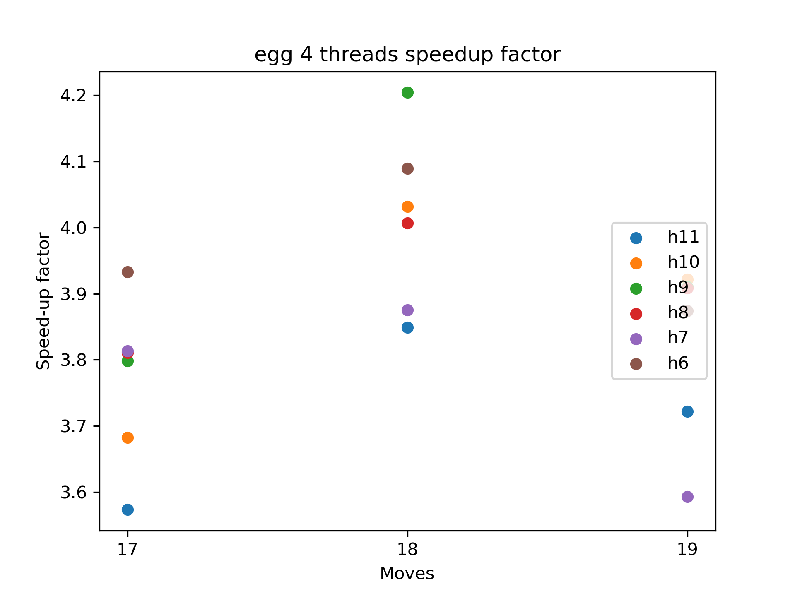
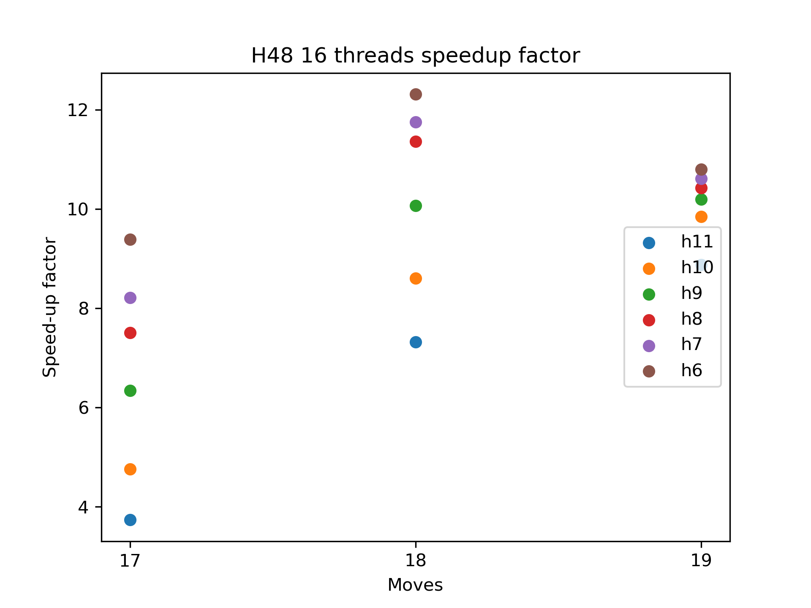
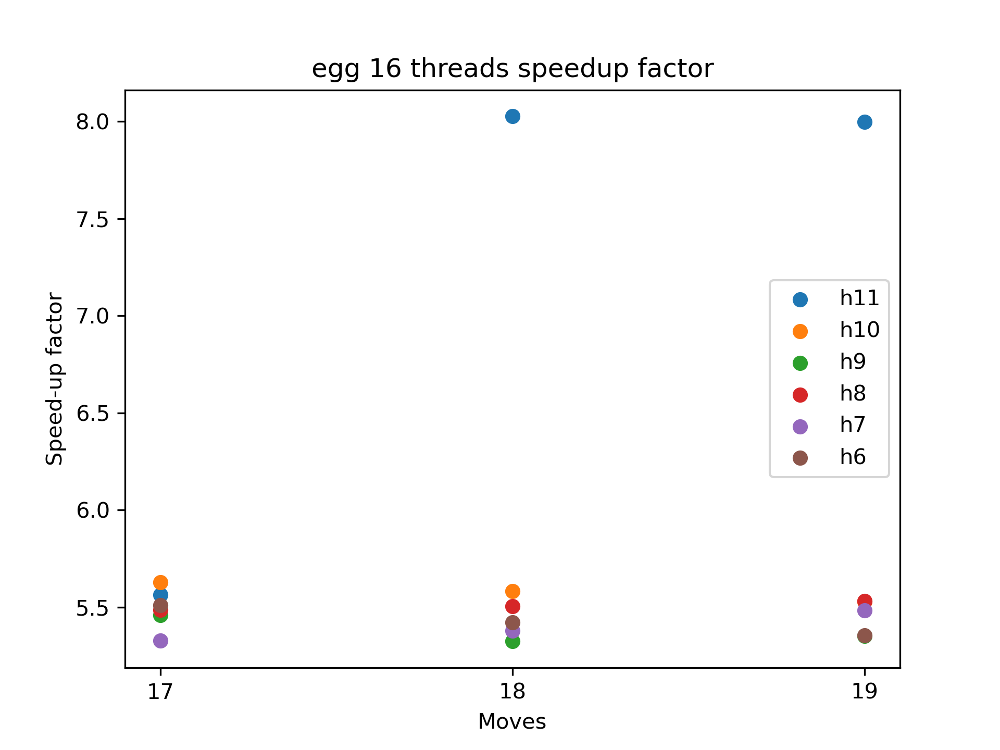

# Benchmarks for the H48 optimal solver and comparison with vcube

This page contains some benchmarks for some of the possible
configurations of the H48 optimal solver. For comparison we also
include similar measurements for two other optimal solvers:

* Andrew Skalski's [vcube](https://github.com/Voltara/vcube), which
  is a truly impressive implementation of Tomas Rokicki's 
  [nxopt](https://github.com/rokicki/cube20src/blob/master/nxopt.md)
  that has been taken as a reference throughout the development of H48.
  This solver also uses an A* search, but the search is supported
  by different pruning tables.
* Arhan Chaudhary's
  [egg-solver](https://github.com/ArhanChaudhary/egg-solver), which
  is an AI-generated implementation of the H48 method with
  highly-optimized microthreading.

Similar benchmarks can be found:

* In Chen Shuang's
  [dedicated github page](https://github.com/cs0x7f/cube_solver_test/wiki),
  which includes many more solvers. At the time of writing, the version
  of H48 used for these benchmarks is a rather old one. Note that
  cube48opt is a re-implementation of the H48 solver by Chen Shuang.
* In Enrico Tenuti's [thesis](https://github.com/enricotenuti/h48thesis),
  also using an old implementation of H48, but including more data and
  nice plots.
* In [the documentation page](https://egg-solver/arhan.sh/docs/index.html)
  for egg-solver.

## Setting

*All movecounts are in Half Turn Metric*

For the benchmarks we used some sets of random positions that can be found
in `benchmarks/scrambles`. We divide them by optimal solution length,
because the time to solve a scramble grows exponentially on the number of
moves, so mixing up positions with long and short solutions is going to
make the shorter solution almost irrelevant. Even within the same solution
length the time to solve a random position can vary significantly,
so we have used sets of 25 scrambles and taken the average of those,
except for the [Superflip](https://en.wikipedia.org/wiki/Superflip),
which is a single scramble.

For short solutions, the very low numbers we get with the largest solver
may be particularly inaccurate, because writing the solution (together
with some log messages) to standard output may take a significant portion
of the time, depending on the terminal emulator used and other factors.

All benchmark tests were done on the following configuration:

* CPU: AMD Ryzen 7 7700 (8 cores, 16 virtual threads)
* Memory: 2x Corsair Vengeance 32GB 5600MHz
* Motherboard: Gigabyte B650M K
* Operating system: Debian 13 (Linux kernel 6.12)
* Compilers: GCC 14.2.0 for H48, Chhang 19.1.7 for vcube and
  cargo 1.99.1 for egg-solver

## Benchmark results

### Single solution, single thread

The first test we performed was finding a single optimal solution, and
we compared the results with vcube.

This test was run in a single-thread configuration, because the three
solvers use very different strategies for multithreading: vcube can only
parallelize by solving one cube per thread, while H48 and egg-solver can
take advantage of multiple threads even when solving a single cube.
Therefore we prefer to compare their single-threaded performance only.

Since the size of the pruning table used by the solver is of utmost
importance, we include two statistics: time per cube and time per cube
*adjusted by table size*.  The adjustment we took simply consists in
multiplying the time per cube by the size of the table. Empirically this
leads to more even results across the board, although the speed of the
solvers of the same family does not scale exactly linearly with the size
of the pruning table.

<!-- The following details block can be found in benchmarks/tables_1_thread.md -->

Results: Single solution, single thread

Time per cube (in seconds, lower is better).

|Solver|Size|17 moves|18 moves|19 moves|20 moves|Superflip|
|:-----|:---|-------:|-------:|-------:|-------:|--------:|
|vcube 212 |58.2 GiB|    0.11|    0.75|    3.43|   27.28|    19.30|
|egg h11   |58.0 GiB|    0.01|    0.06|    0.24|    2.16|     0.14|
|H48 h11   |56.5 GiB|    0.08|    0.43|    1.86|   12.20|    15.39|
|vcube 404 |31.8 GiB|    0.23|    1.24|    6.10|   59.33|   268.26|
|egg h10   |29.0 GiB|    0.02|    0.10|    0.47|    4.00|     0.23|
|H48 h10   |28.3 GiB|    0.13|    0.69|    3.37|   23.15|    38.00|
|vcube 308 |21.2 GiB|    0.17|    1.02|    6.20|   58.70|   604.35|
|egg h9    |14.5 GiB|    0.03|    0.19|    0.91|        |         |
|H48 h9    |14.1 GiB|    0.22|    1.43|    6.56|        |         |
|vcube 208 | 7.3 GiB|    0.56|    4.36|   20.58|        |         |
|egg h8    | 7.2 GiB|    0.07|    0.39|    1.82|        |         |
|H48 h8    | 7.1 GiB|    0.46|    3.43|   14.18|        |         |
|egg h7    | 3.6 GiB|    0.11|    0.81|    4.35|        |         |
|H48 h7    | 3.5 GiB|    0.63|    4.84|   23.31|        |         |
|vcube 112 | 2.4 GiB|    0.96|    9.29|   40.52|        |         |
|egg h6    | 1.8 GiB|    0.20|    1.53|    8.19|        |         |
|H48 h6    | 1.8 GiB|    1.26|    9.51|   47.14|        |         |

Time per cube adjusted for table size (in seconds \* GiB, lower is better).

|Solver|Size|17 moves|18 moves|19 moves|20 moves|Superflip|
|:-----|:---|-------:|-------:|-------:|-------:|--------:|
|vcube 212 |58.2 GiB|    6.43|   43.80|  199.38| 1587.43|  1122.73|
|egg h11   |58.0 GiB|    0.55|    3.31|   13.99|  125.17|     8.04|
|H48 h11   |56.5 GiB|    4.56|   24.55|  104.96|  689.22|   869.37|
|vcube 404 |31.8 GiB|    7.40|   39.47|  194.01| 1887.94|  8535.87|
|egg h10   |29.0 GiB|    0.50|    2.90|   13.69|  115.88|     6.80|
|H48 h10   |28.3 GiB|    3.62|   19.45|   95.15|  654.05|  1073.69|
|vcube 308 |21.2 GiB|    3.51|   21.71|  131.50| 1245.26| 12819.94|
|egg h9    |14.5 GiB|    0.47|    2.74|   13.19|        |         |
|H48 h9    |14.1 GiB|    3.11|   20.18|   92.68|        |         |
|vcube 208 | 7.3 GiB|    4.08|   31.74|  149.68|        |         |
|egg h8    | 7.2 GiB|    0.48|    2.82|   13.16|        |         |
|H48 h8    | 7.1 GiB|    3.23|   24.26|  100.15|        |         |
|egg h7    | 3.6 GiB|    0.39|    2.94|   15.77|        |         |
|H48 h7    | 3.5 GiB|    2.22|   17.12|   82.35|        |         |
|vcube 112 | 2.4 GiB|    2.33|   22.53|   98.23|        |         |
|egg h6    | 1.8 GiB|    0.36|    2.76|   14.83|        |         |
|H48 h6    | 1.8 GiB|    2.24|   16.80|   83.33|        |         |

As we can see, egg-solver is the clear winner, consistently beating H48 by
factors of 5.3x-8.8x for 17-19 moves scrambles, comparing tables of similar
size. Moreover, egg-solver is more than 100 times faster when solving the
superflip configuration.

Adjusting for table size, H48 is generally faster than vcube. The gap between
the two solvers is larger for scrambles with longer optimal solutions.

### Single solution, multiple threads

The same benchmark as before is repeated using 4 and 16 threads (recall
that the CPU used for these tests has 8 physical cores and 16 virtual
threads).

For the reasons mentioned above, we will only compare H48 and egg-solver
in this section.

<!-- The following details block can be found in benchmarks/tables_4_threads.md -->

Results: Single solution, 4 threads

Time per cube (in seconds, lower is better).

|Solver|Size|17 moves|18 moves|19 moves|20 moves|Superflip|
|:-----|:---|-------:|-------:|-------:|-------:|--------:|
|egg h11   |58.0 GiB|    0.00|    0.01|    0.06|    0.55|     0.03|
|H48 h11   |56.5 GiB|    0.03|    0.13|    0.50|    3.24|     4.17|
|egg h10   |29.0 GiB|    0.00|    0.03|    0.12|    1.05|     0.09|
|H48 h10   |28.3 GiB|    0.05|    0.18|    0.90|    6.21|     9.85|
|egg h9    |14.5 GiB|    0.01|    0.05|    0.23|        |         |
|H48 h9    |14.1 GiB|    0.07|    0.39|    1.73|   12.50|    18.97|
|egg h8    | 7.2 GiB|    0.02|    0.10|    0.48|        |         |
|H48 h8    | 7.1 GiB|    0.13|    0.91|    3.71|        |         |
|egg h7    | 3.6 GiB|    0.03|    0.21|    1.11|        |         |
|H48 h7    | 3.5 GiB|    0.18|    1.29|    6.19|        |         |
|egg h6    | 1.8 GiB|    0.05|    0.39|    2.11|        |         |
|H48 h6    | 1.8 GiB|    0.34|    2.48|   12.33|        |         |

Speed-up factor (higher is better).

|Solver|Size|17 moves|18 moves|19 moves|20 moves|Superflip|
|:-----|:---|-------:|-------:|-------:|-------:|--------:|
|egg h11   |58.0 GiB|    3.77|    3.90|    3.89|    3.93|     5.42|
|H48 h11   |56.5 GiB|    2.51|    3.44|    3.75|    3.77|     3.69|
|egg h10   |29.0 GiB|    3.88|    3.77|    3.98|    3.81|     2.72|
|H48 h10   |28.3 GiB|    2.79|    3.91|    3.75|    3.73|     3.86|
|egg h9    |14.5 GiB|    3.90|    3.87|    3.88|        |         |
|H48 h9    |14.1 GiB|    3.18|    3.66|    3.79|        |         |
|egg h8    | 7.2 GiB|    3.87|    3.91|    3.81|        |         |
|H48 h8    | 7.1 GiB|    3.48|    3.78|    3.82|        |         |
|egg h7    | 3.6 GiB|    3.87|    3.87|    3.93|        |         |
|H48 h7    | 3.5 GiB|    3.43|    3.75|    3.77|        |         |
|egg h6    | 1.8 GiB|    3.98|    3.90|    3.87|        |         |
|H48 h6    | 1.8 GiB|    3.73|    3.84|    3.82|        |         |

<!-- The following details block can be found in benchmarks/tables_16_threads.md -->

Results: Single solution, 16 threads

Time per cube (in seconds, lower is better).

|Solver|Size|17 moves|18 moves|19 moves|20 moves|Superflip|
|:-----|:---|-------:|-------:|-------:|-------:|--------:|
|egg h11   |58.0 GiB|    0.00|    0.01|    0.03|    0.27|     0.02|
|H48 h11   |56.5 GiB|    0.02|    0.06|    0.21|    1.16|     1.84|
|egg h10   |29.0 GiB|    0.00|    0.02|    0.09|    0.77|     0.04|
|H48 h10   |28.3 GiB|    0.03|    0.08|    0.34|    2.24|     4.21|
|egg h9    |14.5 GiB|    0.01|    0.04|    0.17|        |         |
|H48 h9    |14.1 GiB|    0.03|    0.14|    0.64|    4.43|     8.04|
|egg h8    | 7.2 GiB|    0.01|    0.07|    0.33|        |         |
|H48 h8    | 7.1 GiB|    0.06|    0.30|    1.36|        |         |
|egg h7    | 3.6 GiB|    0.02|    0.15|    0.79|        |         |
|H48 h7    | 3.5 GiB|    0.08|    0.41|    2.20|        |         |
|egg h6    | 1.8 GiB|    0.04|    0.28|    1.53|        |         |
|H48 h6    | 1.8 GiB|    0.13|    0.77|    4.37|        |         |

Speed-up factor (higher is better).

|Solver|Size|17 moves|18 moves|19 moves|20 moves|Superflip|
|:-----|:---|-------:|-------:|-------:|-------:|--------:|
|egg h11   |58.0 GiB|    5.56|    8.03|    8.00|    8.05|     8.45|
|H48 h11   |56.5 GiB|    3.73|    7.32|    8.87|   10.54|     8.35|
|egg h10   |29.0 GiB|    5.63|    5.58|    5.53|    5.18|     6.05|
|H48 h10   |28.3 GiB|    4.76|    8.60|    9.84|   10.34|     9.03|
|egg h9    |14.5 GiB|    5.46|    5.32|    5.35|        |         |
|H48 h9    |14.1 GiB|    6.34|   10.07|   10.19|        |         |
|egg h8    | 7.2 GiB|    5.49|    5.50|    5.53|        |         |
|H48 h8    | 7.1 GiB|    7.51|   11.36|   10.43|        |         |
|egg h7    | 3.6 GiB|    5.33|    5.38|    5.48|        |         |
|H48 h7    | 3.5 GiB|    8.21|   11.75|   10.61|        |         |
|egg h6    | 1.8 GiB|    5.51|    5.42|    5.35|        |         |
|H48 h6    | 1.8 GiB|    9.38|   12.31|   10.80|        |         |

We can see that both egg-solver and H48 scale pretty well with 4 threads,
getting close to the 4x theoretical maximum speedup in slower cases
(small table or long solutions). egg-solver managed to beat the 4x
speedup for the superflip, likely due to single-scramble variance, i.e.
the thread that found the solution stopped earlier.

In the 16 threads benchmark shows that, although the virtual threads
help push H48 beyond the 8x theoretical speedup that would be provided
by the 8 cores, it is nowhere near a 16x speedup. egg-solver seems
stuck around 5.5x speedup.

### All solutions

Finally, we ran a test on finding *all* optimal solutions which, as
far as I know, is a use case not supported by vcube or egg-solver.
For convenience, this test is only run on 16 threads.

<!-- The following details block can be found in benchmarks/tables_all_solutions.md -->

Results: All solutions, 16 threads

Time per cube (in seconds, lower is better).

|Solver|Size|17 moves|18 moves|19 moves|20 moves|Superflip|
|:-----|:---|-------:|-------:|-------:|-------:|--------:|
|H48 h11   |56.5 GiB|    0.04|    0.24|    1.88|    3.88|     1.86|
|H48 h10   |28.3 GiB|    0.05|    0.39|    3.51|    7.54|     4.29|
|H48 h9    |14.1 GiB|    0.08|    0.73|    6.92|        |         |
|H48 h8    | 7.1 GiB|    0.16|    1.54|   14.78|        |         |
|H48 h7    | 3.5 GiB|    0.22|    2.37|   25.35|        |         |
|H48 h6    | 1.8 GiB|    0.40|    4.58|   50.17|        |         |

Time per cube adjusted for table size (in seconds \* GiB, lower is better).

|Solver|Size|17 moves|18 moves|19 moves|20 moves|Superflip|
|:-----|:---|-------:|-------:|-------:|-------:|--------:|
|H48 h11   |56.5 GiB|    2.00|   13.40|  106.21|  219.43|   105.10|
|H48 h10   |28.3 GiB|    1.45|   11.13|   99.17|  212.94|   121.20|
|H48 h9    |14.1 GiB|    1.13|   10.25|   97.80|        |         |
|H48 h8    | 7.1 GiB|    1.10|   10.85|  104.41|        |         |
|H48 h7    | 3.5 GiB|    0.79|    8.38|   89.57|        |         |
|H48 h6    | 1.8 GiB|    0.71|    8.10|   88.68|        |         |

## Other notes

* To repeat the benchmarks for H48, use `./benchmarks/run-h48-benchmarks.sh`.
  Similar scripts for vcube and egg-solver can be found in the `benchmarks`
  folder.
* All the measurements above exclude the time needed to load the pruning
  tables into memory, which can be quite significant for large tables.
* The measurements also excluded the one-off computation of the pruning
  tables which, for reasons related to the cube coordinates used, is
  significantly slower for H48 compared to vcube.
* H48's and vcube's approach to multithreading are extremely different:
  H48 parallelize the search for each cube individually, vcube solves
  multiple cubes in parallel by dedicating a single thread to each of
  them. Both apporaches have pros and cons: vcube's approch has less
  overhead in coordination between the threads, but often some threads
  may be left without work when there are no more cubes left to solve.
* Per-cube parallelization means that H48 will always be faster than
  vcube when solving a single cube.
* vcube only supports x86 processors (Intel, AMD), while H48 runs on any
  architecture, including e.g. ARM (Macbook M series, android phones)
  and can be compiled to WebAssembly as well.
* For H48, both GCC and Clang have been tried, with the same options;
  the resulting executable was about 10% faster with GCC compared to Clang.
  vcube only supports compiling with Clang.
