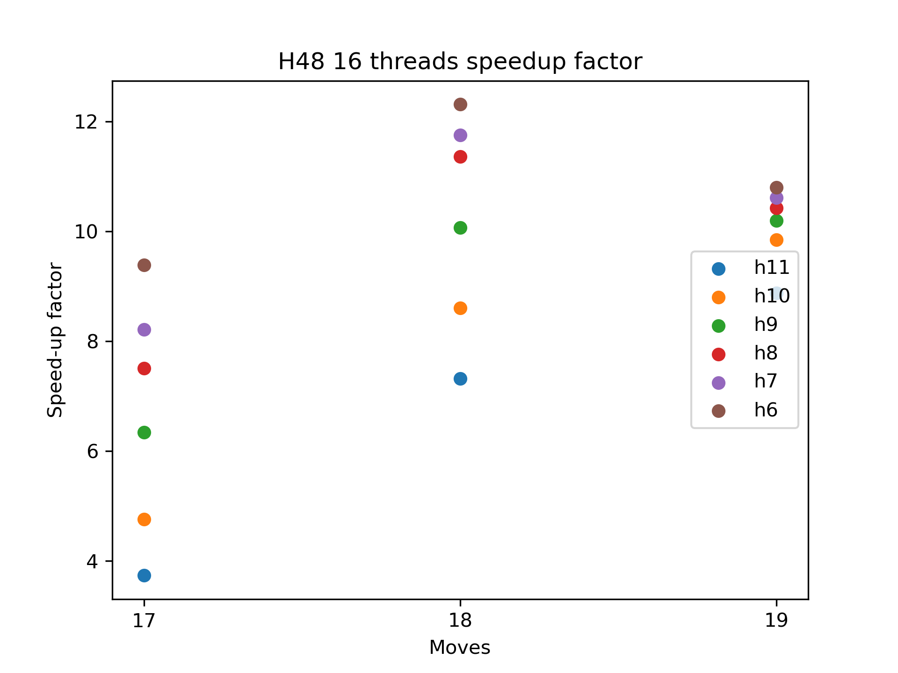
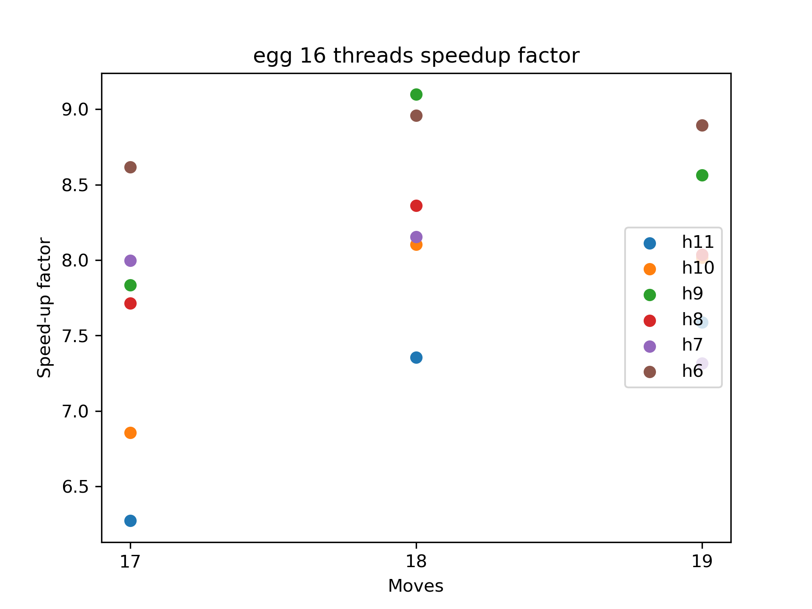

<!-- The following details block can be found in benchmarks/tables_16_threads.md -->

Results: Single solution, 16 threads

Time per cube (in seconds, lower is better).

|Solver|Size|17 moves|18 moves|19 moves|20 moves|Superflip|
|:-----|:---|-------:|-------:|-------:|-------:|--------:|
|egg h11   |58.0 GiB|    0.00|    0.01|    0.03|    0.28|     0.02|
|H48 h11   |56.5 GiB|    0.02|    0.06|    0.21|    1.16|     1.84|
|egg h10   |29.0 GiB|    0.00|    0.01|    0.06|    0.50|     0.03|
|H48 h10   |28.3 GiB|    0.03|    0.08|    0.34|    2.24|     4.21|
|egg h9    |14.5 GiB|    0.00|    0.02|    0.11|        |         |
|H48 h9    |14.1 GiB|    0.03|    0.14|    0.64|    4.43|     8.04|
|egg h8    | 7.2 GiB|    0.01|    0.04|    0.21|        |         |
|H48 h8    | 7.1 GiB|    0.06|    0.30|    1.36|        |         |
|egg h7    | 3.6 GiB|    0.01|    0.09|    0.53|        |         |
|H48 h7    | 3.5 GiB|    0.08|    0.41|    2.20|        |         |
|egg h6    | 1.8 GiB|    0.02|    0.18|    0.97|        |         |
|H48 h6    | 1.8 GiB|    0.13|    0.77|    4.37|        |         |

Speed-up factor (higher is better).

|Solver|Size|17 moves|18 moves|19 moves|20 moves|Superflip|
|:-----|:---|-------:|-------:|-------:|-------:|--------:|
|egg h11   |58.0 GiB|    6.27|    7.35|    7.59|    7.76|     7.61|
|H48 h11   |56.5 GiB|    3.73|    7.32|    8.87|   10.54|     8.35|
|egg h10   |29.0 GiB|    6.86|    8.10|    8.02|    7.92|     7.13|
|H48 h10   |28.3 GiB|    4.76|    8.60|    9.84|   10.34|     9.03|
|egg h9    |14.5 GiB|    7.84|    9.10|    8.56|        |         |
|H48 h9    |14.1 GiB|    6.34|   10.07|   10.19|        |         |
|egg h8    | 7.2 GiB|    7.71|    8.36|    8.04|        |         |
|H48 h8    | 7.1 GiB|    7.51|   11.36|   10.43|        |         |
|egg h7    | 3.6 GiB|    8.00|    8.15|    7.32|        |         |
|H48 h7    | 3.5 GiB|    8.21|   11.75|   10.61|        |         |
|egg h6    | 1.8 GiB|    8.62|    8.96|    8.89|        |         |
|H48 h6    | 1.8 GiB|    9.38|   12.31|   10.80|        |         |

