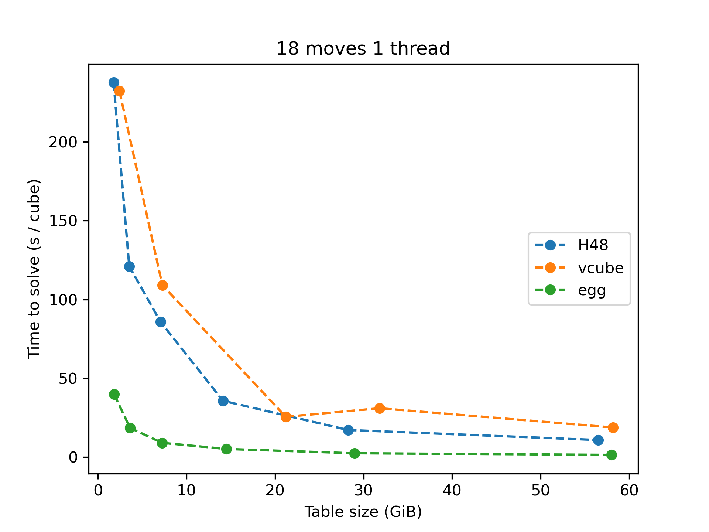
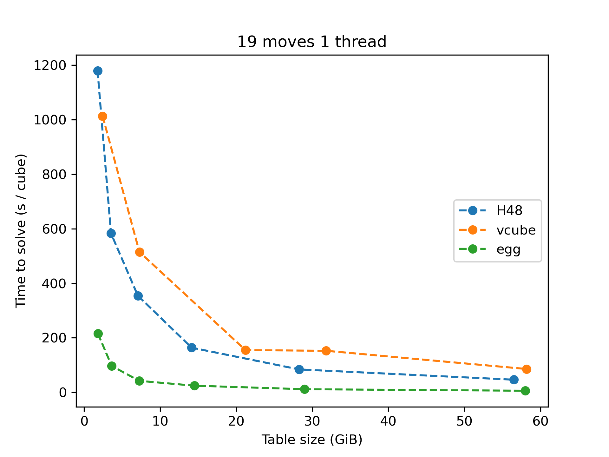
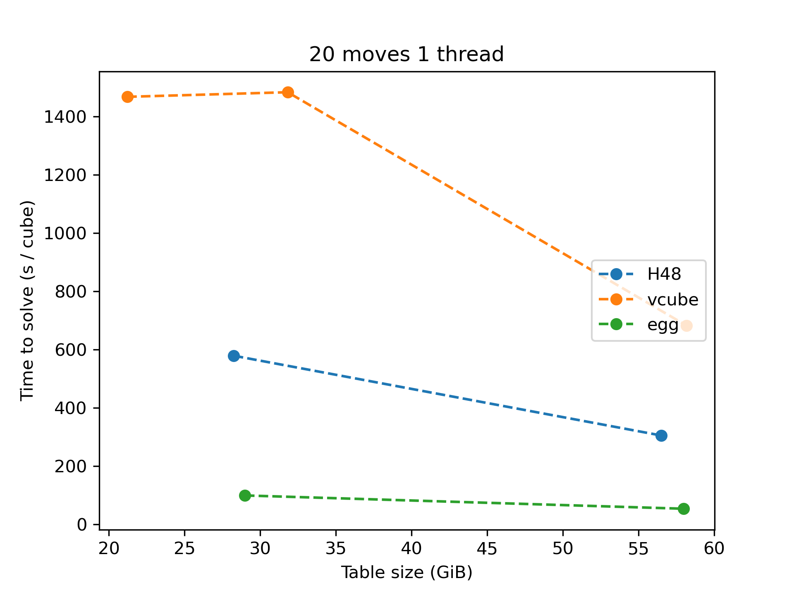

<!-- The following details block can be found in benchmarks/tables_1_thread.md -->

Results: Single solution, single thread

Time per cube (in seconds, lower is better).

|Solver|Size|17 moves|18 moves|19 moves|20 moves|Superflip|
|:-----|:---|-------:|-------:|-------:|-------:|--------:|
|vcube 212 |58.2 GiB|    0.11|    0.75|    3.43|   27.28|    19.30|
|egg h11   |58.0 GiB|    0.01|    0.06|    0.24|    2.14|     0.14|
|H48 h11   |56.5 GiB|    0.08|    0.43|    1.86|   12.20|    15.39|
|vcube 404 |31.8 GiB|    0.23|    1.24|    6.10|   59.33|   268.26|
|egg h10   |29.0 GiB|    0.02|    0.10|    0.46|    3.96|     0.24|
|H48 h10   |28.3 GiB|    0.13|    0.69|    3.37|   23.15|    38.00|
|vcube 308 |21.2 GiB|    0.17|    1.02|    6.20|   58.70|   604.35|
|egg h9    |14.5 GiB|    0.03|    0.21|    0.98|        |         |
|H48 h9    |14.1 GiB|    0.22|    1.43|    6.56|        |         |
|vcube 208 | 7.3 GiB|    0.56|    4.36|   20.58|        |         |
|egg h8    | 7.2 GiB|    0.06|    0.36|    1.69|        |         |
|H48 h8    | 7.1 GiB|    0.46|    3.43|   14.18|        |         |
|egg h7    | 3.6 GiB|    0.10|    0.74|    3.88|        |         |
|H48 h7    | 3.5 GiB|    0.63|    4.84|   23.31|        |         |
|vcube 112 | 2.4 GiB|    0.96|    9.29|   40.52|        |         |
|egg h6    | 1.8 GiB|    0.21|    1.60|    8.62|        |         |
|H48 h6    | 1.8 GiB|    1.26|    9.51|   47.14|        |         |

Time per cube adjusted for table size (in seconds \* GiB, lower is better).

|Solver|Size|17 moves|18 moves|19 moves|20 moves|Superflip|
|:-----|:---|-------:|-------:|-------:|-------:|--------:|
|vcube 212 |58.2 GiB|    6.43|   43.80|  199.38| 1587.43|  1122.73|
|egg h11   |58.0 GiB|    0.55|    3.32|   13.97|  124.06|     7.93|
|H48 h11   |56.5 GiB|    4.56|   24.55|  104.96|  689.22|   869.37|
|vcube 404 |31.8 GiB|    7.40|   39.47|  194.01| 1887.94|  8535.87|
|egg h10   |29.0 GiB|    0.48|    2.85|   13.48|  114.83|     7.08|
|H48 h10   |28.3 GiB|    3.62|   19.45|   95.15|  654.05|  1073.69|
|vcube 308 |21.2 GiB|    3.51|   21.71|  131.50| 1245.26| 12819.94|
|egg h9    |14.5 GiB|    0.50|    3.00|   14.22|        |         |
|H48 h9    |14.1 GiB|    3.11|   20.18|   92.68|        |         |
|vcube 208 | 7.3 GiB|    4.08|   31.74|  149.68|        |         |
|egg h8    | 7.2 GiB|    0.45|    2.63|   12.27|        |         |
|H48 h8    | 7.1 GiB|    3.23|   24.26|  100.15|        |         |
|egg h7    | 3.6 GiB|    0.36|    2.69|   14.05|        |         |
|H48 h7    | 3.5 GiB|    2.22|   17.12|   82.35|        |         |
|vcube 112 | 2.4 GiB|    2.33|   22.53|   98.23|        |         |
|egg h6    | 1.8 GiB|    0.37|    2.89|   15.62|        |         |
|H48 h6    | 1.8 GiB|    2.24|   16.80|   83.33|        |         |

