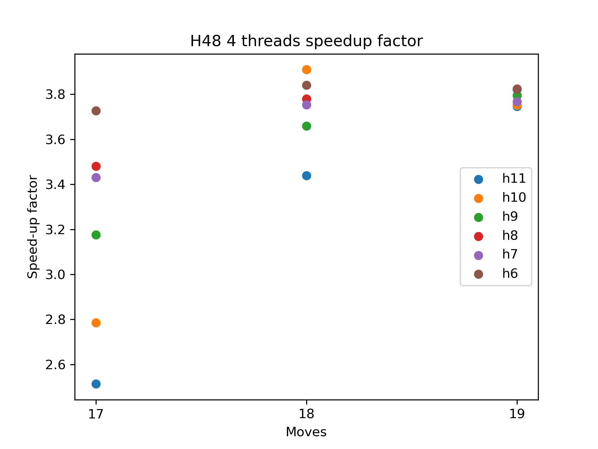
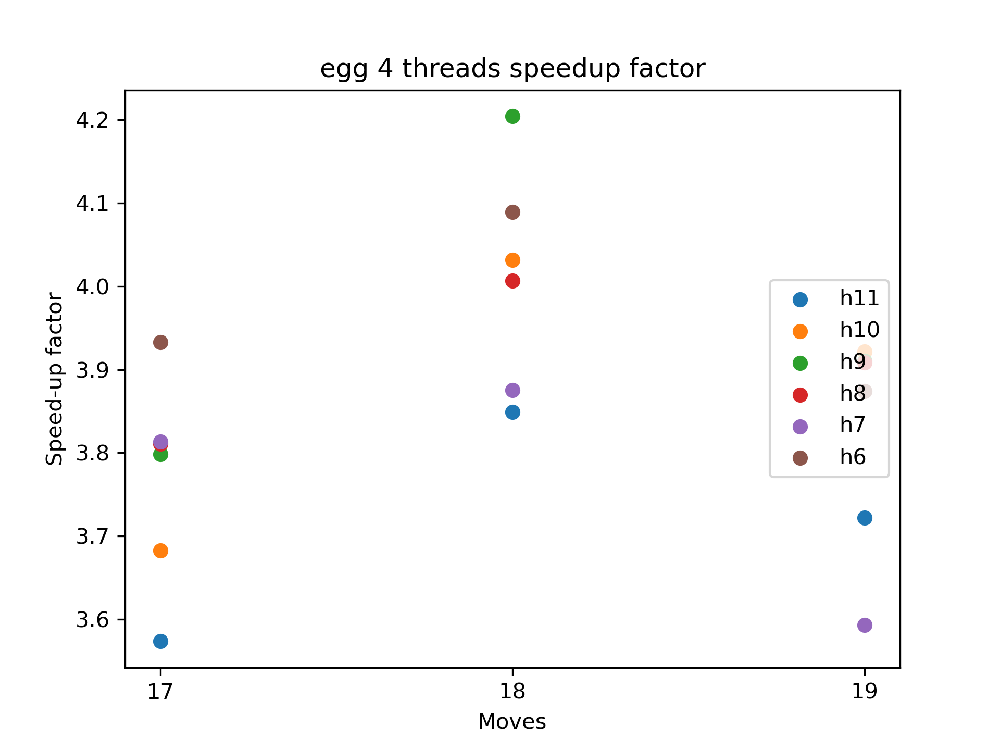

<!-- The following details block can be found in benchmarks/tables_4_threads.md -->

Results: Single solution, 4 threads

Time per cube (in seconds, lower is better).

|Solver|Size|17 moves|18 moves|19 moves|20 moves|Superflip|
|:-----|:---|-------:|-------:|-------:|-------:|--------:|
|egg h11   |58.0 GiB|    0.00|    0.01|    0.06|    0.55|     0.03|
|H48 h11   |56.5 GiB|    0.03|    0.13|    0.50|    3.24|     4.17|
|egg h10   |29.0 GiB|    0.00|    0.02|    0.12|    1.02|     0.09|
|H48 h10   |28.3 GiB|    0.05|    0.18|    0.90|    6.21|     9.85|
|egg h9    |14.5 GiB|    0.01|    0.05|    0.25|        |         |
|H48 h9    |14.1 GiB|    0.07|    0.39|    1.73|   12.50|    18.97|
|egg h8    | 7.2 GiB|    0.02|    0.09|    0.43|        |         |
|H48 h8    | 7.1 GiB|    0.13|    0.91|    3.71|        |         |
|egg h7    | 3.6 GiB|    0.03|    0.19|    1.08|        |         |
|H48 h7    | 3.5 GiB|    0.18|    1.29|    6.19|        |         |
|egg h6    | 1.8 GiB|    0.05|    0.39|    2.23|        |         |
|H48 h6    | 1.8 GiB|    0.34|    2.48|   12.33|        |         |

Speed-up factor (higher is better).

|Solver|Size|17 moves|18 moves|19 moves|20 moves|Superflip|
|:-----|:---|-------:|-------:|-------:|-------:|--------:|
|egg h11   |58.0 GiB|    3.57|    3.85|    3.72|    3.90|     5.41|
|H48 h11   |56.5 GiB|    2.51|    3.44|    3.75|    3.77|     3.69|
|egg h10   |29.0 GiB|    3.68|    4.03|    3.92|    3.89|     2.78|
|H48 h10   |28.3 GiB|    2.79|    3.91|    3.75|    3.73|     3.86|
|egg h9    |14.5 GiB|    3.80|    4.20|    3.91|        |         |
|H48 h9    |14.1 GiB|    3.18|    3.66|    3.79|        |         |
|egg h8    | 7.2 GiB|    3.81|    4.01|    3.91|        |         |
|H48 h8    | 7.1 GiB|    3.48|    3.78|    3.82|        |         |
|egg h7    | 3.6 GiB|    3.81|    3.88|    3.59|        |         |
|H48 h7    | 3.5 GiB|    3.43|    3.75|    3.77|        |         |
|egg h6    | 1.8 GiB|    3.93|    4.09|    3.87|        |         |
|H48 h6    | 1.8 GiB|    3.73|    3.84|    3.82|        |         |

