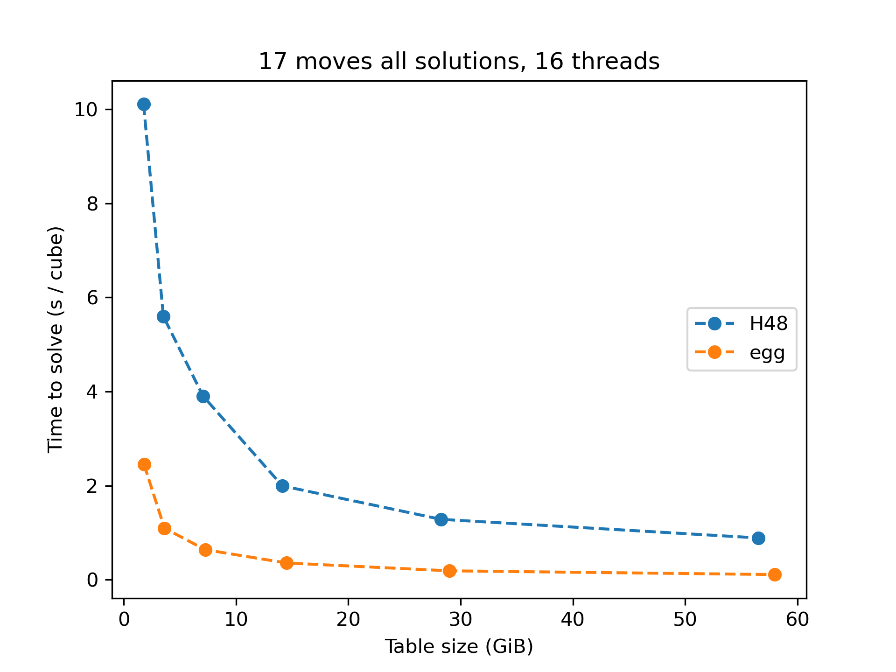
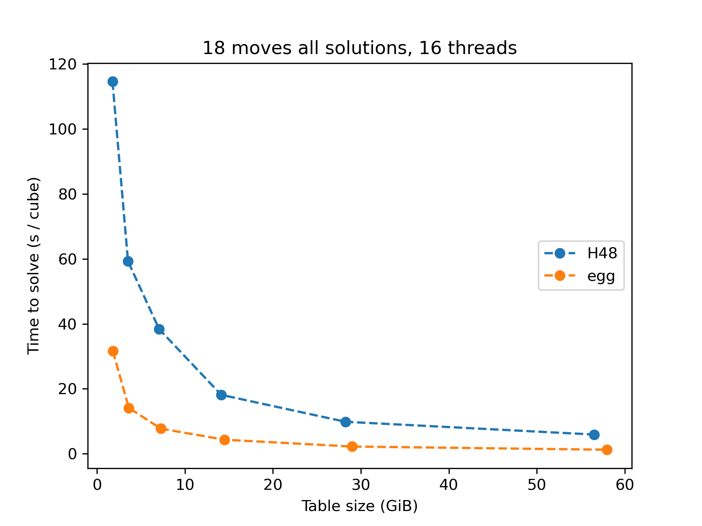
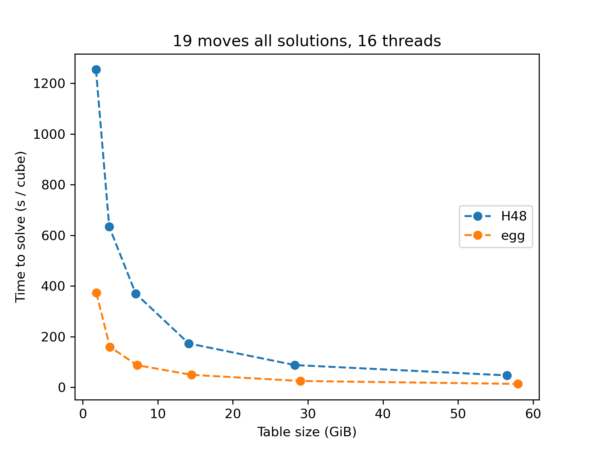
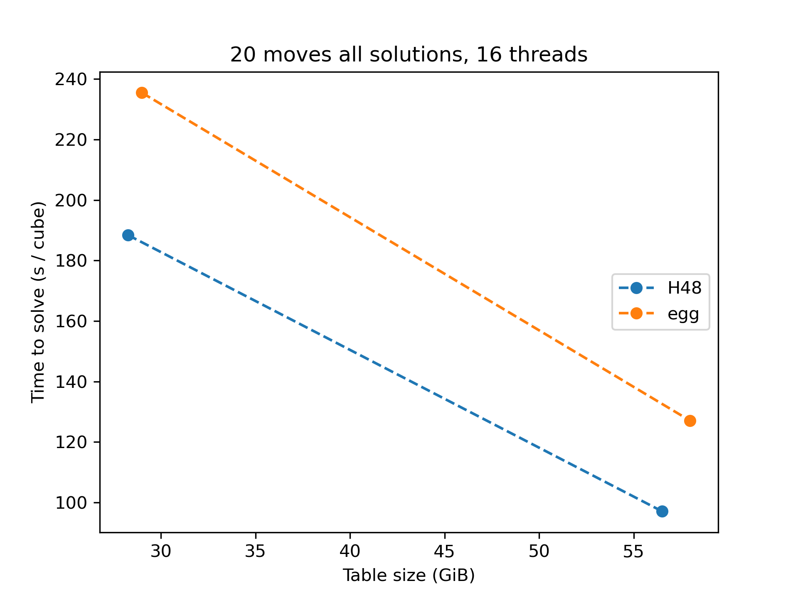

<!-- The following details block can be found in benchmarks/tables_all_solutions.md -->

Results: All solutions, 16 threads

Time per cube (in seconds, lower is better).

|Solver|Size|17 moves|18 moves|19 moves|20 moves|Superflip|
|:-----|:---|-------:|-------:|-------:|-------:|--------:|
|egg h11   |58.0 GiB|    0.00|    0.05|    0.54|    5.08|    15.38|
|H48 h11   |56.5 GiB|    0.04|    0.24|    1.88|    3.88|     1.86|
|egg h10   |29.0 GiB|    0.01|    0.09|    1.00|    9.42|    31.05|
|H48 h10   |28.3 GiB|    0.05|    0.39|    3.51|    7.54|     4.29|
|egg h9    |14.5 GiB|    0.01|    0.17|    1.97|        |         |
|H48 h9    |14.1 GiB|    0.08|    0.73|    6.92|        |         |
|egg h8    | 7.2 GiB|    0.03|    0.31|    3.49|        |         |
|H48 h8    | 7.1 GiB|    0.16|    1.54|   14.78|        |         |
|egg h7    | 3.6 GiB|    0.04|    0.57|    6.38|        |         |
|H48 h7    | 3.5 GiB|    0.22|    2.37|   25.35|        |         |
|egg h6    | 1.8 GiB|    0.10|    1.27|   14.93|        |         |
|H48 h6    | 1.8 GiB|    0.40|    4.58|   50.17|        |         |

Time per cube adjusted for table size (in seconds \* GiB, lower is better).

|Solver|Size|17 moves|18 moves|19 moves|20 moves|Superflip|
|:-----|:---|-------:|-------:|-------:|-------:|--------:|
|egg h11   |58.0 GiB|    0.25|    2.88|   31.12|  294.67|   892.07|
|H48 h11   |56.5 GiB|    2.00|   13.40|  106.21|  219.43|   105.10|
|egg h10   |29.0 GiB|    0.22|    2.58|   28.89|  273.08|   900.34|
|H48 h10   |28.3 GiB|    1.45|   11.13|   99.17|  212.94|   121.20|
|egg h9    |14.5 GiB|    0.21|    2.51|   28.49|        |         |
|H48 h9    |14.1 GiB|    1.13|   10.25|   97.80|        |         |
|egg h8    | 7.2 GiB|    0.18|    2.25|   25.30|        |         |
|H48 h8    | 7.1 GiB|    1.10|   10.85|  104.41|        |         |
|egg h7    | 3.6 GiB|    0.16|    2.05|   23.11|        |         |
|H48 h7    | 3.5 GiB|    0.79|    8.38|   89.57|        |         |
|egg h6    | 1.8 GiB|    0.18|    2.29|   27.06|        |         |
|H48 h6    | 1.8 GiB|    0.71|    8.10|   88.68|        |         |

